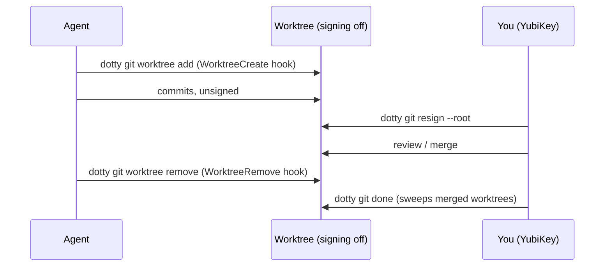

<!--
  Copyright 2026 Bitwise Media Group Ltd
  SPDX-License-Identifier: MIT
-->

# Agent worktrees & re-signing

Hardened coding agents run in a sandbox that cannot reach your YubiKey — so they
cannot sign commits. Rather than weaken signing (or the sandbox), dotty gives
agents **git worktrees where signing is switched off**, and a one-command way to
re-sign the history afterwards with your hardware key.



## Lifecycle

[`dotty git worktree add`](../cli/dotty_git_worktree_add.md) creates (or reuses)
a worktree on an `agent/<repo>-<suffix>` branch and prints its path. It only
reuses an existing directory that is a worktree of the same repository — two
repositories with the same basename would otherwise collide under a shared root.

[`dotty git worktree remove`](../cli/dotty_git_worktree_remove.md) (alias `end`)
removes the worktree, its tmux session, and the `agent/*` branch; any other
branch survives. It forces past what plain `git worktree remove` refuses —
populated submodules, locks, a dirty tree — but asks first (default No) when
work would be lost: uncommitted changes, or commits found on no remote and no
other local branch. Pass `--yes` to skip the question; without a terminal and
without `--yes` it refuses. It never removes a repository's main checkout, and
with no path it removes the linked worktree you are standing in.

[`dotty git done`](../cli/dotty_git_done.md) closes the loop: before deleting
branches already merged into trunk it removes their worktrees, prompting for any
worktree with uncommitted changes and keeping it (and its branch) if you decline
or no terminal is attached.

Where worktrees live is a per-profile setting (`dotty init --worktrees`):

- **Shared root** (default `~/.local/share/dotty/worktrees`) — one directory
  outside every repository holds all repos' worktrees, named `<repo>-<suffix>`.
  Linters and mise never walk into them from the parent repo, and a worktree
  never picks up its parent repo's mise config by walking up. The hardened
  sandboxes add the root to their writable roots.
- **Repo-relative** (e.g. `.worktrees`) — each repository keeps its own agent
  worktrees inside itself; the shared global gitignore keeps the directory out
  of git.

!!! note "Migrating from `.worktrees`"

    Earlier releases defaulted to the repo-relative `.worktrees`. Re-running
    `dotty init` moves a profile still on that default to the shared root (pass
    `--worktrees .worktrees` to keep it). The global gitignore keeps listing
    `.worktrees/` so leftovers don't show up as untracked; clear them with
    `dotty git worktree remove <path>` or `dotty git done` once merged.

The resolved location is exported as `$DOTTY_WORKTREES` by the active profile's
`env.zsh`, which is also how the [Neovim session picker](../reference/neovim.md)
finds and groups worktree sessions under ++"<leader>"+f+s++.

## Hook wiring

Both verbs also accept their agent hook JSON on stdin, so they wire directly
into agent hooks with no glue: the scaffolded Claude Code settings map
`WorktreeCreate` → `dotty git worktree add` and `WorktreeRemove` →
`dotty git worktree remove --yes` (Claude has already asked whether to keep the
worktree by the time the hook fires). When Claude Code creates an isolated
worktree for a task, dotty places it in the configured location and names the
branch; when the worktree is discarded, dotty cleans up the branch and tmux
session too.

!!! warning "Not every worktree gets a removal hook"

    Claude Code never fires `WorktreeRemove` for subagent or workflow
    worktrees (`isolation: "worktree"`), keeps interactive worktrees that have
    changes, and its periodic cleanup skips hook-created worktrees. Those are
    collected only by `dotty git done` — once their branch has merged — or by
    an explicit `dotty git worktree remove`.

## The signing hand-off

Inside agent worktrees, commit and tag signing are **off** — the shared git
config's final include, `~/.config/dotty/active-profile/worktrees.gitconfig`,
applies `commit.gpgSign=false` to any `gitdir` under `.git/worktrees/`. Agents
commit freely; nothing blocks on a key that isn't there.

Signing is restored two ways:

- **`commit.sh`** — the shared agent memory doc teaches every agent to emit a
  `commit.sh` script with the exact commit (or re-sign) commands for you to run
  outside the sandbox. It's in the global gitignore, so a stray script never
  lands in history.
- **[`dotty git resign`](../cli/dotty_git_resign.md)** — rebase and re-sign a
  range with your hardware key:

  ```sh
  dotty git resign --root            # every commit in the branch's history
  dotty git resign main              # just main..HEAD
  dotty git resign main --reset-author
  ```

  `--reset-author` also resets each commit's author to your current git identity
  and rewrites author trailers — useful when the agent committed as itself.

!!! warning "Resigning rewrites history"

    Commits get new SHAs. `dotty git resign` prompts before rewriting
    (skip with `--yes`); do it before the branch is shared, or expect a
    force-push.

## A typical run

1. An agent session starts a task; the `WorktreeCreate` hook calls
   `dotty git worktree add`, and work happens on `agent/myrepo-fix-tests` in
   `~/.local/share/dotty/worktrees/myrepo-fix-tests`.
2. The agent commits as it goes — unsigned, Conventional Commits.
3. You review, then `dotty git resign main` — every commit after `main` is
   re-signed by your YubiKey (touch once per commit).
4. Merge or propose the branch; the `WorktreeRemove` hook (or
   `dotty git worktree remove`) cleans up the worktree, branch, and tmux session
   — and if it never fired, `dotty git done` collects the worktree once the
   branch has landed.
